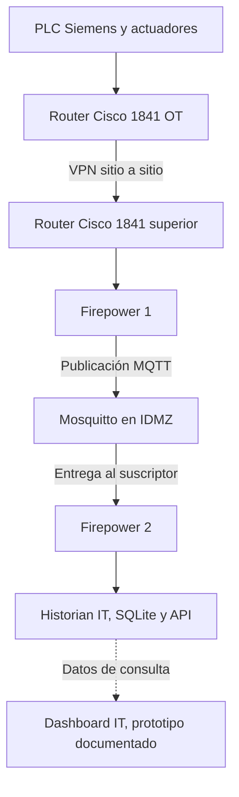

# Reto IT/OT — Arquitectura consolidada de telemetría industrial

**Corte documental:** 19 de noviembre de 2026.

**Estado:** transporte de telemetría desde PLC reales hasta IT confirmado por el equipo; implementación del dashboard pendiente, con pantalla y contrato documentados para handoff.

## 1. Alcance y funcionamiento

Los PLC Siemens controlan los actuadores neumáticos del proceso y generan datos de operación. La integración transporta esa telemetría a la red IT mediante dos routers Cisco 1841 y una zona desmilitarizada industrial (IDMZ) delimitada por dos Cisco Firepower 1010. El equipo confirmó que el S7-1500 en `192.168.0.43` ejecuta `FB_Telemetria` y `LMQTT_Client`, inicia la sesión MQTT hacia Mosquitto y publica directamente; el rol del S7-1200 sigue pendiente de confirmación.

El broker Mosquitto de la IDMZ recibe las publicaciones del S7-1500. La VM Historian en IT inicia su propia conexión como suscriptora con `it_historian`, registra los mensajes en SQLite y ofrece una API de consulta HTTP. El dashboard consumirá los datos desde IT. El alcance de esta versión termina en la red IT. La integración con la nube se planteó en una iteración anterior y carece de validación en el alcance actual.

Las flechas representan el sentido de los datos de proceso. En el segundo cruce de seguridad, el Historian inicia la conexión TCP desde IT hacia Mosquitto en IDMZ y recibe las publicaciones como tráfico de retorno de esa sesión. El término *flujo unidireccional* se aplica a la telemetría de aplicación. MQTT, TCP y la VPN intercambian tráfico de control en ambos sentidos.

## 2. Inventario y direccionamiento

Las direcciones se toman del PDF de telemetría más reciente, salvo el S7-1500, confirmado por el equipo. Las IP WAN se registraron por DHCP y corresponden a la sesión documentada.

| Zona o enlace | Componente | Dirección o interfaz | Función y observación |
|---|---|---|---|
| OT | S7-1500, publicador MQTT | `192.168.0.43/24` | Confirmado por el equipo: ejecuta `FB_Telemetria` y `LMQTT_Client`, inicia MQTT con `ot_plc` y publica directamente. El PDF lo describía como simulación con laptop Windows; esa descripción quedó superada. El rol del S7-1200 está pendiente. |
| OT / WAN CEM | Router Cisco 1841 OT | LAN `192.168.0.1`, WAN `10.48.25.204` DHCP | Gateway OT y extremo de la VPN. |
| WAN CEM / tránsito | Router Cisco 1841 superior | WAN `10.48.27.145` DHCP, LAN `192.168.30.2/24` | Segundo extremo de la VPN. El PDF identifica la interfaz LAN como `FastEthernet0/1`. |
| Tránsito / IDMZ | Cisco Firepower 1 | `ot` `192.168.30.1/24`, `idmz` `192.168.10.2/24` | Filtra el acceso al broker desde OT. |
| IDMZ | Laptop Windows con Mosquitto 2.1.2 | `192.168.10.10/24`, gateway `192.168.10.1` | Intermediario MQTT entre publicador y suscriptor. |
| IDMZ / IT | Cisco Firepower 2 | `idmz` `192.168.10.1/24`, `it` `192.168.20.1/24` | Permite al Historian iniciar su sesión con el broker. |
| IT | VM Historian, Alpine Linux | `192.168.20.20/24`, gateway `192.168.20.1` | Suscriptor MQTT, SQLite y API HTTP. |
| IT | Laptop Windows | `192.168.20.10/24`, gateway `192.168.20.1` | Cliente de consulta. El frontend sigue en desarrollo; la recomendación de esta ronda es servir el dashboard desde este equipo y mantener el Historian como origen de datos. |

Firepower 1 tiene documentada una ruta a `192.168.0.0/24` vía `192.168.30.2`. El broker tiene documentada una ruta persistente a esa red vía `192.168.10.2` para que las respuestas a OT regresen por Firepower 1. Su gateway `192.168.10.1` corresponde a Firepower 2 para el retorno a IT. El mapa de puertos de switch y VLAN del montaje actual queda pendiente de confirmar.

## 3. Matriz de comunicaciones

| Origen de la sesión | Destino | Servicio | Propósito y control documentado |
|---|---|---|---|
| Router Cisco 1841 OT y router superior | Par VPN sobre WAN CEM | IPsec / ISAKMP | Transporte entre extremos. Falta el anexo con parámetros negociados y evidencia del túnel. |
| S7-1500 `192.168.0.43` | Mosquitto `192.168.10.10` | MQTT TCP 1883 | Publicación directa por Firepower 1. Cuenta `ot_plc` con escritura en `planta/telemetria/integracion`. IP origen confirmada por el equipo. |
| Historian `192.168.20.20` | Mosquitto `192.168.10.10` | MQTT TCP 1883 | El Historian inicia la sesión por Firepower 2. Cuenta `it_historian` con lectura en el mismo tópico y retorno dentro de la sesión establecida. |
| Cliente IT `192.168.20.10` | Historian `192.168.20.20` | HTTP TCP 8081 | Consulta en la subred IT. |

La política documentada busca impedir el tráfico directo OT–IT y las nuevas sesiones iniciadas desde IDMZ hacia los extremos. Los nombres, objetos y alcance de las reglas activas en FDM quedan por contrastar con una exportación o captura de cada firewall. La VPN protege su tramo entre routers. El PDF documenta MQTT en TCP 1883 y HTTP en TCP 8081, ambos sin TLS documentado. La autenticación MQTT y las ACL del broker limitan quién puede publicar y suscribirse.

## 4. Contrato de telemetría y consulta

- Mosquitto tiene acceso anónimo deshabilitado según el PDF. Las ACL aplican escritura para `ot_plc` y lectura para `it_historian` sobre `planta/telemetria/integracion`.
- La configuración de integración documenta QoS 1 y `retain=false`. QoS 1 admite reentregas. El Historian emplea `UNIQUE(run_id, source, seq)` e `INSERT OR IGNORE` para que el mismo identificador de lectura ocupe una sola fila en SQLite. La implementación del Historian no está incluida en este repositorio; la regla se cita del PDF y no se verificó en código en esta ronda.
- El JSON documentado contiene `run_id`, `source`, `seq`, `timestamp` y el objeto `variables`. El ejemplo del PDF (`temperatura_c`, `presion_bar`, `motor_run`, 2026-11-18) quedó superado por los datos reales del 19 de noviembre: el equipo confirmó los tres booleanos `piston1_act`, `piston2_act` y `piston3_act`. La corrida de referencia es `INTEGRACION-001` / `PLC-SIEMENS-01`: `seq=1` a las `21:40:00Z` con las tres señales en `false`, y `seq=2` a las `21:40:05Z` con solo `piston1_act` en `true`. El significado físico de cada tag sigue pendiente.
- El PDF documenta `GET /health` y `GET /telemetry?limit=50&run_id=<ID>`, con la consulta en orden del registro más reciente al más antiguo. El equipo confirmó que `GET /telemetry` devuelve un arreglo de objetos con `id`, `run_id`, `source`, `seq`, `timestamp`, `received_at` y `variables`. El código de `it_historian_service.py`, `it_query_client.py` y `ot_plc_publisher.py` no está disponible en este repositorio ni se localizó en el equipo; la forma de respuesta, el orden, el límite, el filtro y la respuesta vacía quedan documentados pero no verificados contra la implementación. El handoff `HANDOFF_Dashboard_ITOT_2026-11-19.md` detalla el contrato y las comprobaciones pendientes.

## 5. Conciliación con las versiones anteriores

| Tema | Antecedente | Referencia para el montaje actual |
|---|---|---|
| Adquisición OT | La Etapa 4 propuso OPC UA. La línea base física usó una laptop publicadora y el baseline del 7 de noviembre ensayó la VM `colector-ot` en `192.168.100.20`. | El equipo confirma que el S7-1500 en `192.168.0.43` es el publicador MQTT directo, con `FB_Telemetria` y `LMQTT_Client`. El rol del S7-1200 queda pendiente. |
| Perímetro inferior | La línea base física documentó `192.168.30.0/24` como segmento OT de conexión directa. | El PDF reciente documenta esa subred como tránsito entre el router superior y Firepower 1. La LAN OT documentada detrás del primer router es `192.168.0.0/24`. |
| Interfaces IDMZ | La arquitectura de red anterior asignaba `.10.1` a Firepower 1 y `.10.2` a Firepower 2. El baseline del 7 de noviembre ya registraba `.10.2` en Firepower 1. | El PDF reciente fija Firepower 1 en `192.168.10.2` y Firepower 2 en `192.168.10.1`, coherente con la ruta de retorno y el gateway del broker que documenta. |
| Consumo IT | La laptop IT se suscribía directamente en la línea base física. La VM `historian-dmz` ya aparecía como cliente de la red IT en el baseline. | La VM Historian figura como suscriptor y servidor HTTP. La laptop IT figura como cliente de consulta. |
| Broker y tópico | La línea base física describía acceso anónimo y `planta/telemetria`. Se evaluó un puente `bridge.py` en TCP 5000 y se descartó. | El PDF reciente documenta autenticación, ACL por rol y `planta/telemetria/integracion`. El retorno MQTT usa la sesión que inicia IT. |

## 6. Estado y evidencia de cierre

| Elemento | Estado en este corte | Evidencia para el expediente |
|---|---|---|
| PLC → routers → IDMZ → IT | Operativo según el equipo; S7-1500 confirmado como publicador | Correlacionar una misma lectura real utilizando `run_id`, `source` y `seq` en origen, suscriptor y consulta IT. Los dos registros de `INTEGRACION-001` son la primera referencia de esa correlación. |
| VPN, firewalls y broker | Topología y controles descritos en el PDF reciente | Anexar estado de las asociaciones IPsec, reglas FDM activas y resultados de los flujos permitidos y bloqueados, sin incluir secretos. |
| SQLite y API | Implementación descrita en el PDF reciente; código no disponible en el repositorio | Incorporar una fila de ejemplo de una corrida real y la respuesta correspondiente de `/telemetry`. El equipo ya aportó dos registros de `INTEGRACION-001`; falta la respuesta HTTP completa con `id` y `received_at` reales. |
| Dashboard | Diseño y contrato documentados; implementación pendiente | Incorporar la validación visual cuando el frontend consuma datos reales. El handoff `HANDOFF_Dashboard_ITOT_2026-11-19.md` fija pantalla, polling, estados, simulación y criterios de aceptación. |

## 7. Evidencia de esta ronda y límites

| Nivel | Qué cubre | Dónde está |
|---|---|---|
| Confirmado por el equipo (2026-11-19) | Rol del S7-1500, cuentas MQTT, dos registros de `INTEGRACION-001` y campos de `/telemetry`. | Este documento, §1, §3 y §4; fixture del handoff. |
| Documentado en el PDF | Topología, IPs, Mosquitto, ACL, QoS, SQLite, endpoints `/health` y `/telemetry`, orden y parámetros. | PDF citado en Fuentes. |
| Verificado en el repositorio | Al iniciar la ronda, el repo solo tenía `README.md` trackeado; no hay código de backend, Historian ni frontend; no hay `package.json`, `requirements.txt`, Dockerfile ni compose. | `git ls-files`, `git log`, inspección de árbol. |
| No verificable en esta ronda | Comportamiento real de `/telemetry` y `/health`, respuesta vacía, límites, filtro, CORS, firewall y acceso desde la laptop IT. | Pendiente de montaje físico o de acceso a la VM Historian. |

## Fuentes del proyecto

1. *Documentación Técnica – Arquitectura de Telemetría Industrial OT-IDMZ-IT(1)*, §§1–5. Fuente principal para el inventario, el transporte y la aplicación.
2. *Documentación Técnica – Arquitectura de Red Industrial Segmentada (OT-IDMZ-IT)*, §§2–7. Referencia para la línea base física, los cambios de roles y el diseño del broker.
3. *Reto_ITOT_baseline_2026-11-07.md*, §§1–3 y 5. Referencia para la integración KVM/libvirt y el diagnóstico de la etapa intermedia.
4. *Etapa 4 – Diseño seguro de la arquitectura*. Antecedente de la matriz de conductos y la propuesta inicial con OPC UA.
5. Actualización del equipo del 19 de noviembre de 2026. Fuente para el estado operativo desde los PLC hasta IT, el rol del S7-1500 y los dos registros de `INTEGRACION-001`.
6. *HANDOFF_Dashboard_ITOT_2026-11-19.md*. Handoff del prototipo del dashboard: pantalla, contrato de polling, estados, simulación y criterios de aceptación.
